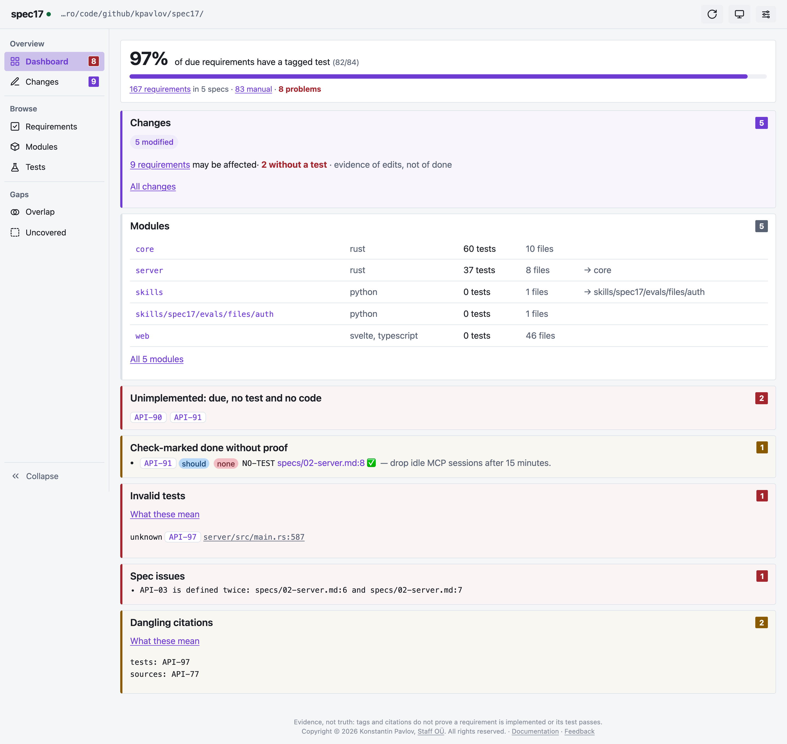
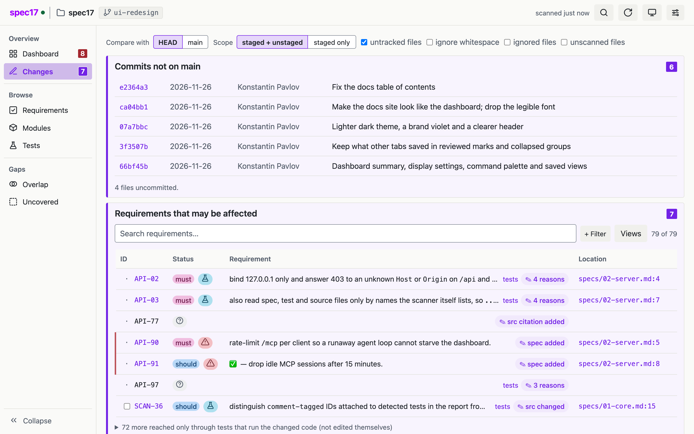

# spec17

[spec17.dev](https://spec17.dev)

[](https://github.com/kpavlov/spec17/actions/workflows/build.yml)

spec17 links requirements in Markdown to tagged tests and source comments. It helps you find missing test tags, spot stale references, and see which requirements a Git change touches. The scanner produces the same results for the same inputs and runs without an LLM.

> **Evidence, not truth.** A citation or tag shows where a requirement is referenced. spec17 does not run tests or verify that a requirement is met.

Use spec17 from the CLI, the web dashboard, or an assistant connected through MCP over HTTP or stdio. Compatible MCP clients can open the dashboard as an MCP App. An optional CodeGraph index adds test-to-code links and helps find overlap and uncovered declarations.

<picture>
  <source media="(prefers-color-scheme: dark)" srcset="docs/static/img/dashboard-dark.png">
  
</picture>

## Quickstart

Install a prebuilt release with Homebrew on an Apple Silicon Mac or on Linux (arm64 or x86_64). For other platforms, see [Build from source](https://spec17.dev/quickstart/#build-from-source).

```sh
brew tap kpavlov/spec17 https://github.com/kpavlov/spec17
brew install kpavlov/spec17/spec17
spec17 --version
```

For a prebuilt development version on Apple Silicon, install `kpavlov/spec17/spec17-dev`. Both formulas install `spec17`, so uninstall one before switching to the other.

From the project you want to scan, run `spec17 report` for a terminal summary or `spec17` to open the dashboard.

```sh
cd /path/to/your/repo
spec17 report
spec17
```

To connect a client that reads `.mcp.json`, run `spec17 install` from the project root and keep `spec17` running. For stdio and manual configuration, see [MCP setup](https://spec17.dev/agents/).

<picture>
  <source media="(prefers-color-scheme: dark)" srcset="docs/static/img/changes-dark.png">
  
</picture>

## Documentation

- [Install spec17 and scan a sample project](https://spec17.dev/quickstart/)
- [Look up CLI commands, dashboard options, and CodeGraph setup](https://spec17.dev/usage/)
- [Write requirements, tag tests, and configure the scanner](https://spec17.dev/specs/)
- [Connect an MCP client and look up its tools and resources](https://spec17.dev/agents/)

## Develop

To build spec17, install stable Rust, Node.js, and the pnpm version pinned in `web/package.json`. The release binary embeds the dashboard and runs without these build tools. Development commands scan this repository by default.

```sh
make dev                      # Vite HMR + Rust server on :7411, opens the browser
make run                      # release binary with the UI embedded, serves on :7411
make build                    # target/release/spec17
make install                  # cargo install into ~/.cargo/bin (make uninstall to remove)
make report                   # text report
make test                     # cargo tests
make bench                    # compare scan times at main and HEAD
make docs                     # build the Hugo site in docs/ into docs/public (Hugo >= 0.146)
make site                     # preview the docs at localhost:1313
make dev ROOT=/path/to/repo PORT=7500 OPEN=0
```

Without `make`:

```sh
(cd web && pnpm install --frozen-lockfile && pnpm run build)
SKIP_WEB_BUILD=1 cargo install --path server --locked   # or: cargo build --release, then target/release/spec17
```

`SKIP_WEB_BUILD=1` reuses an existing build in `web/dist`. Debug builds serve the dashboard through Vite at `localhost:5173`.

- `core/` contains the scanner and reports.
- `server/` contains the CLI and MCP server.
- `web/` contains the Svelte dashboard.
- `skills/` contains the bundled agent skill.
- `docs/` contains the Hugo site for spec17.dev.
- `bench/` contains the benchmark script.

## Releases

For a tagged release, start from a clean checkout with the version set in `Cargo.toml`. Push the tag and dispatch the Linux x86_64, Linux ARM64, and Windows x86_64 builds:

```sh
git tag v0.1.0
git push origin v0.1.0
gh workflow run prerelease.yml -f tag=v0.1.0
```

On a Mac, build, sign, and upload its native archive to the same prerelease. The Mac and CI uploads can happen in either order.

```sh
git checkout v0.1.0
make upload TAG=v0.1.0
```

After all uploads finish, run the tap workflow. It verifies the release archives and updates `Formula/spec17.rb` on the default branch. Rerun it if you replace an archive. When the workflow succeeds, promote the prerelease.

```sh
gh workflow run tap.yml -f tag=v0.1.0
# Wait for the tap workflow to succeed before promoting.
gh release edit v0.1.0 --prerelease=false --latest
```

Archives are named `spec17-<version>-<os>-<arch>.tar.gz` (`.zip` on Windows), each with a `.sha256` file. Use `make dist` to package locally. The Mac build signs ad hoc by default. Set `SIGN_IDENTITY` on `make upload` or `make dist` to use another signing identity. Run the upload on each Mac architecture you want to ship. Uploads require an authenticated `gh`, and tap generation requires permission for the workflow token to push to the default branch.

### Dev releases

On an Apple Silicon Mac, run this from a clean `main` matching `origin/main`.

```sh
make release-dev
```

The command builds and signs a timestamped archive, uploads it with its checksum to the rolling prerelease, and writes `Formula/spec17-dev.rb`. Commit and push that file to publish the Homebrew update. Users get the new binary with `brew update && brew upgrade spec17-dev`. [Rolling prerelease](https://github.com/kpavlov/spec17/releases/tag/edge)

`spec17 --version` and the dashboard's Settings screen show the dev build's commit and UTC build time, for example `0.1.0-dev+a91c8e8b23c4 (2026-11-20T18:08:16Z)`.

Homebrew's standard HEAD option still builds the default branch locally.

```sh
brew install --HEAD kpavlov/spec17/spec17
```

If the repository is private, set `HOMEBREW_GITHUB_API_TOKEN` to a token with repository read access for prebuilt downloads.

## Benchmark

`make bench` compares CLI wall time across Git revisions using the same generated repository. Each invocation includes a full scan.

```sh
make bench                                      # main vs HEAD, scale 1, 10 runs
make bench REVS="main HEAD ." SCALE=4 RUNS=20   # `.` is the working tree, uncommitted changes included
make bench JSON=1                               # one JSON document instead of a Markdown table (for scripts and agents)
python3 bench/bench.py --help
```

The first revision is the baseline. Compare the median times and check the output hashes to confirm that the results still match. The benchmark uses release builds, Python's standard library, and bullet specs without a CodeGraph index.

Example from `make bench REVS="." SCALE=4 RUNS=10` on one Mac. The project had 8,000 requirements, 1,600 source files, 400 test files, and 400 docs. Times are in milliseconds.

| command | median | min | stdev |
|---|--:|--:|--:|
| `report` | 121.3 | 118.9 | 3.0 |
| `status --all` | 148.1 | 145.5 | 2.4 |
| `trace GEN-0001` | 123.1 | 121.7 | 1.7 |

On that machine, runs varied by a few percent between sessions. Treat differences under about 3% as noise for this workload.
